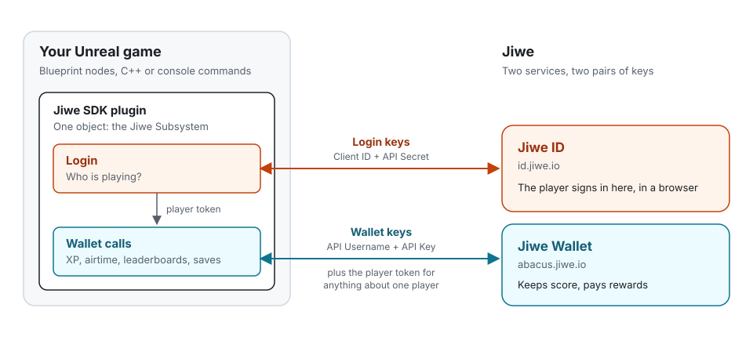
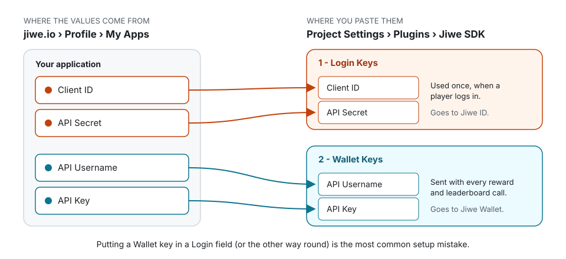
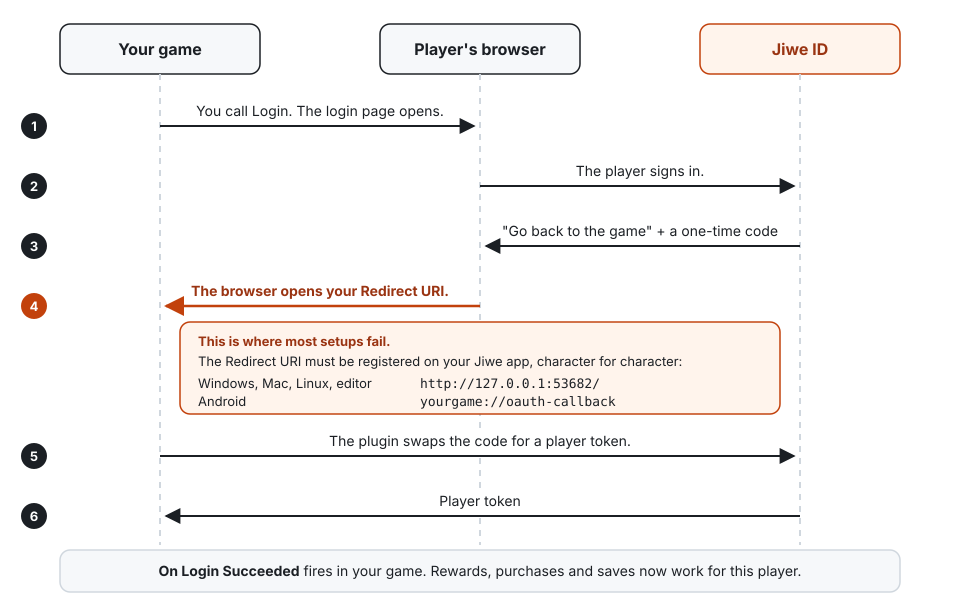
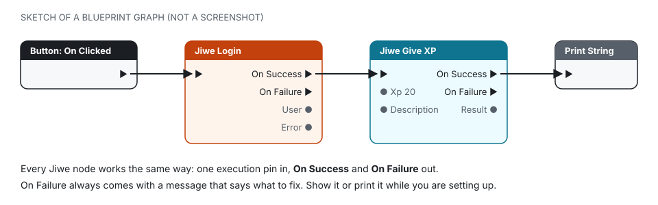

# Jiwe SDK for Unreal Engine

Let players log in with their Jiwe account, earn XP and airtime, climb leaderboards, buy
in-game items from their Jiwe wallet and keep cloud saves.

Works from **Blueprint**, **C++** and the **console**. Windows, Mac and Linux (login through
the browser), and Android (experimental). Written for Unreal Engine 5.3 to 5.8.

> **Preview 0.1.0.** This is the first build and has not yet been through a full test
> pass. See [What has and has not been tested](#what-has-and-has-not-been-tested).
> If you are the first tester, start with [docs/TESTING.md](docs/TESTING.md).

---

## The big picture



Three things to remember:

1. There is **one object** to talk to: the **Jiwe Subsystem**. It always exists while the
   game runs. Nothing to place in a level, nothing to wire up.
2. Jiwe is **two services**. *Jiwe ID* knows who the player is. *Jiwe Wallet* keeps score
   and pays rewards.
3. Each service has its **own pair of keys**. Orange is login, teal is wallet, in every
   diagram here.

---

## Set up in 5 steps

### 1. Add the plugin

1. Close the Unreal editor.
2. Copy this folder into your project as `YourProject/Plugins/JiweSDK/`
   (create `Plugins` if it does not exist).
3. Open the project. Unreal offers to build the plugin: choose **Yes**.
4. Check **Edit > Plugins**, search for "Jiwe": **Jiwe SDK** should be ticked.

The plugin is C++, so your computer needs a compiler (Visual Studio 2022 with the
*Game development with C++* workload on Windows, Xcode on Mac). If your project is
Blueprint-only, add any C++ class once (**Tools > New C++ Class**) so Unreal can build
plugins for it.

### 2. Create your app on Jiwe

Go to **jiwe.io > Profile > My Apps > Create an Application**. One application per game.

On that form:

- **Redirect URIs**: enter `http://127.0.0.1:53682/` (for Windows, Mac, Linux and the
  editor). Keep the trailing slash. For Android also add `yourgame://oauth-callback`
  (see [Android](#android)). Separate several with commas.
- **Scopes ("My app will...")**: tick **every** box, including both that say
  "Include the user's wallet ID in the token".

Jiwe then shows you four values. Keep the page open.

### 3. Paste the four keys

In Unreal: **Edit > Project Settings > Plugins > Jiwe SDK**.



### 4. Check your setup

Press **Play**, open the console with the backtick key (`` ` ``, left of 1) and type:

```
Jiwe.Status
```

It lists which keys are filled in and prints the **exact Redirect URI** this build sends.
That text must match what you registered in step 2, character for character.

### 5. Log in and award XP

Still in the console:

```
Jiwe.Login
Jiwe.GiveXp 10
Jiwe.Leaderboard
```

`Jiwe.Login` opens your browser. Sign in, and the tab says "Login complete". Back in the
game you see the player's name. That is the whole integration working, before you have
written any code.

---

## What happens when a player logs in



You only write step 1. The plugin does the rest.

Step 4 is where most setups fail. Jiwe will only send the player back to an address you
registered in advance. If login ends with `access_denied` or a "redirect" error, run
`Jiwe.Status` and compare the Redirect URI it prints with your Jiwe app, including the
port number and the trailing slash.

Always give players a **Cancel** button that calls **Cancel Login**. If they close the
browser tab, login otherwise waits until it times out (3 minutes by default).

---

## Using it in your game

### Blueprint

Right-click in a graph and type **Jiwe**.



To read things at any time (is a player logged in? what is their name?), use
**Get Jiwe Subsystem** and call **Is Logged In** or **Get User Info**. To react to login
from anywhere, bind to its **On Login Succeeded** and **On Login Failed** events.

### C++

Add `"JiweSDK"` to `PublicDependencyModuleNames` in your module's `.Build.cs`, then:

```cpp
#include "JiweSubsystem.h"

void AMyGameMode::OnLoginButton()
{
    UJiweSubsystem::Get(this)->LoginWithCallback([this](bool bSuccess, const FString& Error)
    {
        if (!bSuccess) { ShowMessage(Error); return; }

        UJiweSubsystem::Get(this)->GiveXpReward(20, TEXT("Beat boss 1"), [](const FJiweResult& Result)
        {
            UE_LOG(LogTemp, Display, TEXT("XP awarded: %s"), Result.bSuccess ? TEXT("yes") : *Result.Error);
        });
    });
}
```

Every callback runs on the game thread, so it is safe to touch actors and UI inside it.

### What you can call

Calls in the first table need a logged-in player. Calls in the second only need your
Wallet keys, so they work before anyone logs in.

**Needs a logged-in player**

| Blueprint node | C++ | What it does |
|---|---|---|
| Jiwe Login | `Login`, `LoginWithCallback` | Opens the Jiwe login page |
| Jiwe Give XP | `GiveXpReward` | Credits XP. Must be more than 0 |
| Jiwe Give Airtime | `GiveAirtimeReward` | Sends airtime to a phone number from your reward pool |
| Jiwe Purchase With Wallet | `PurchaseWithWallet` | Charges the player's Jiwe wallet for an item |
| Jiwe Get Purchase Status | `GetPurchaseStatus` | Checks a purchase |
| Jiwe Get Rewards Earned | `GetRewardsEarned` | Lifetime totals this player earned from your game |
| Jiwe Get User Data / Set User Data | `GetUserData`, `SetUserData` | Per-player cloud save (JSON) |

**No login needed**

| Blueprint node | C++ | What it does |
|---|---|---|
| Jiwe Get Leaderboard | `GetLeaderboard` | Top players. Read each row's **Score** |
| Jiwe Get Wallet Balance | `GetWalletBalance` | Your app's reward pool |
| Jiwe Get Transaction Status | `GetTransactionStatus` | PENDING, POSTED, FAILED... |
| Jiwe Get Game Data / Set Game Data | `GetGameData`, `SetGameData` | Shared settings for your game (JSON). Treat as public |
| (C++ only) | `CheckCredentialsValid` | Have this build's Wallet keys been switched off? |

Every result has **Success** and **Error**. When Success is false, Error says what went
wrong and usually what to do about it.

### Three rules that save you a support ticket

1. **XP must be more than 0.** Read the score *before* your game-over code resets it.
   The plugin refuses a zero and tells you so.
2. **Purchases need an idempotency key.** Make one per purchase attempt, save it, and
   send the *same* key if you retry after a timeout. A new key on a retry can charge the
   player twice. If a purchase fails with a clear answer (Retryable is false), a fresh
   attempt needs a *new* key.
3. **Airtime comes out of your reward pool.** Check **Jiwe Get Wallet Balance** first and
   tell the player when the pool is low.

---

## Android

Status: written, not yet tested on a device.

1. In the settings page set **Android Redirect Scheme** to a short lowercase name unique
   to your game, for example `kentepunk`. Letters and digits only.
2. On your Jiwe app, add the Redirect URI `kentepunk://oauth-callback`.
3. Package for Android as usual.

That is all. When you package, the plugin adds the link handler to `AndroidManifest.xml`
for you. Change the scheme and you must package again.

## Web

Unreal Engine 5 has no web (HTML5) export from Epic, so there is no web login in this
plugin yet. If you export to the browser with a third-party toolchain, tell us which one:
the login code is built so a web path can be added.

## iOS and consoles

The plugin compiles everywhere, and the "no login needed" calls work everywhere. Login
is not implemented on iOS or consoles yet and fails with a clear message.

---

## When something goes wrong

Run `Jiwe.Status` first. Then:

| What you see | Why | Fix |
|---|---|---|
| "Client ID is empty" | Keys not pasted | Step 3 |
| Browser shows an error, or login fails with `access_denied` | Redirect URI not registered, or a scope box is unticked | Compare `Jiwe.Status` with your Jiwe app. Tick every scope |
| "Port 53682 ... is already in use" | Another program has that port | Pick another **Desktop Loopback Port**, and register the new Redirect URI |
| "Jiwe rejected the login at the last step ... invalid_client" | Wrong Client ID or API Secret, or a Wallet key pasted into a Login field | Re-copy the Login keys |
| "Timed out waiting for the player..." | The player closed the tab or took too long | Let them try again. Raise **Login Timeout Seconds** if needed |
| "No player is logged in" | A player call was made before login | Call Jiwe Login first |
| HTTP 403 on leaderboard or balance | Wrong Wallet keys | Re-copy API Username and API Key |
| HTTP 401 on a reward after a good login | Keys are for a different Jiwe environment, or the login expired | Log in again. Check you are not mixing test and live keys |
| "Account balance is insufficient" on a reward | Your reward pool is empty | Top up your app on Jiwe |
| Leaderboard shows 0 for everyone | You read a raw field | Use each row's **Score** |
| Nothing happens when typing `Jiwe.` commands | The game is not running | Press Play first |

Everything the plugin logs is under **LogJiwe** in the Output Log.

Still stuck? WhatsApp **+254773754444** or **rock@jiwe.io**.

---

## Keeping your keys safe

- The API Secret and API Key are saved in `Config/DefaultGame.ini` and ship inside your
  game. Anyone determined can extract keys from a shipped game. This is true for every
  engine.
- Do not push a project containing live keys to a public repository.
- For rewards worth real money (airtime, large prizes), award them from your own server,
  not from the game.
- Treat Game Data as public: any copy of the game can read it.

---

## Settings reference

**Project Settings > Plugins > Jiwe SDK**

| Group | Setting | What it is |
|---|---|---|
| 1 - Login Keys | Client ID, API Secret | From your Jiwe app. Used to log a player in |
| 2 - Wallet Keys | API Username, API Key | From your Jiwe app. Sent with every wallet call |
| 3 - Redirects | Desktop Loopback Port | Default 53682. Redirect URI is `http://127.0.0.1:<port>/` |
| 3 - Redirects | Android Redirect Scheme | Default `jiwewallet`. Redirect URI is `<scheme>://oauth-callback` |
| 4 - Behaviour | Login On Start | Open the login page when the game starts. Off by default |
| 4 - Behaviour | Login Timeout Seconds | How long the player has in the browser. Default 180 |
| 4 - Behaviour | Network Timeout Seconds | How long to wait for one answer from Jiwe. Default 20 |
| 5 - Advanced | Client Auth, Player Token, Extra Scopes, Wallet Resource | Leave alone unless Jiwe tells you otherwise |
| 6 - Test Environment | Four URLs | Leave empty for live Jiwe. Used for the mock server and Jiwe test environments |

---

## Coming from the Jiwe Unity SDK?

Same Jiwe API, same keys, same Redirect URI rules. What changed:

| Unity | Unreal |
|---|---|
| `JiweAuth` and `JiweWallet` components on a GameObject | One `Jiwe Subsystem`, always there |
| Fields in the Inspector | Project Settings > Plugins > Jiwe SDK |
| `loopbackPort` 0 (random) by default | Fixed port 53682 by default |
| 20 seconds to finish logging in | 180 seconds (separate from the network timeout) |
| `entry.Score` computed from `XP` / `currentXP` / `xp` | Each row has `Score` |
| `loginOnStart` on by default | Off by default |
| WebGL supported | No web export in Unreal 5 |
| Leaderboard rows carry `email` and `phone_number` | Not exposed |

---

## What has and has not been tested

As of 16 November 2026:

| Checked | How |
|---|---|
| SHA-256 used for login (PKCE) | Unit test against published vectors and 500 random inputs |
| Request shapes (login, token, XP, leaderboard, balance) | Replayed against the mock Jiwe server from the Unity SDK tests |
| C++ syntax, names, shadowed variables, format strings | Checked with a compiler against stand-in engine headers, for desktop, Windows and Android |
| Android manifest script and plugin descriptor | Validated as well-formed |

| Not checked yet | |
|---|---|
| A real Unreal Engine build | No engine was available where this was written |
| Login against live Jiwe | Needs a person, a browser and a registered app |
| Android on a device | |
| Blueprint nodes in the editor | |

## Licence

[MIT](LICENSE). Use it in free and commercial games, change it, ship it. Keep the
copyright notice in the plugin folder.
